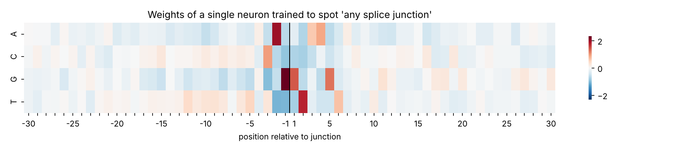

# Can a tiny neural network learn where a gene is spliced?

This is a beginner's machine-learning mini-project in bioinformatics, starting from logistic regression, to a single
artificial neuron trained with hand-written gradient descent, to a small multi-layer perceptron in
PyTorch — all on 3,190 short DNA sequences from the classic UCI splice-junction dataset.



*The 240 weights of one neuron trained to spot a splice junction, laid out by position and base.
Nobody told it about biology, yet the strongest weights are **AG** just before the junction and
**GT** just after — the textbook intron boundary.*

## Results

| model | test accuracy (798 sequences) |
|---|---|
| k-nearest neighbours (k chosen by cross-validation) | 0.851 |
| logistic regression | 0.937 |
| single neuron, gradient descent written by hand (splice site vs none) | 0.934 |
| same neuron via PyTorch autograd | 0.934 (identical weights) |
| MLP, one hidden layer of 32 ReLU units | 0.940 |

Two significant results from this data: (1) the hand-derived gradient and autograd give the same
answer to 7 decimal places, so backpropagation stops being a black box; (2) a model with no
biological prior rediscovers the GT…AG consensus. The MLP's loss curve also shows textbook
overfitting after a few epochs — a useful thing to see for yourself.

## Contents

```
data/splice.data               the dataset (UCI, CC BY 4.0) — see data/README.md
src/splice_utils.py            load the file, one-hot encode sequences, name features
notebooks/01_baseline_sklearn.ipynb     logistic regression + kNN baseline, weight heatmap
notebooks/02_perceptron_to_mlp.ipynb    neuron by hand → autograd → MLP → position importance
figures/                       every plot the notebooks produce
blog/post_outline.md           skeleton for the accompanying blog post
```

## Running it

```bash
conda create -n splice python=3.11
conda activate splice
pip install -r requirements.txt
jupyter lab
```

Both notebooks run in under a minute on my laptop (Macbook Air M4). Random seeds are fixed, so reproducibility should be exact.

## Resources used

* Jean Golding Institute, [Introduction to Data Analysis in Python (Part 2)](https://bristol-training.github.io/data-analysis-python-2/) — notebook 01 uses nothing beyond this course.
* Jean Golding Institute, [Introduction to AI](https://bristol-training.github.io/intro-to-ai/) — notebook 02: perceptron → activation → gradient descent → backprop → MLP.
* Steven Morse, [Neural Networks for a beginner (Part I: theory)](https://stmorse.github.io/journal/Beginner-NN-Part-I.html) — a good walkthrough of the maths. Mainly covers regression with squared error; notebook 02 swaps in a sigmoid/softmax output and cross-entropy loss for classification and shows how the chain rule simplifies.
* Noordewier, Towell & Shavlik (1991), *Training knowledge-based neural networks to recognize genes in DNA sequences*, NeurIPS — the paper the dataset was built for.

## Data

Molecular Biology (Splice-junction Gene Sequences), UCI Machine Learning Repository,
https://doi.org/10.24432/C5M888 (CC BY 4.0). A copy is included so the notebooks run offline.
